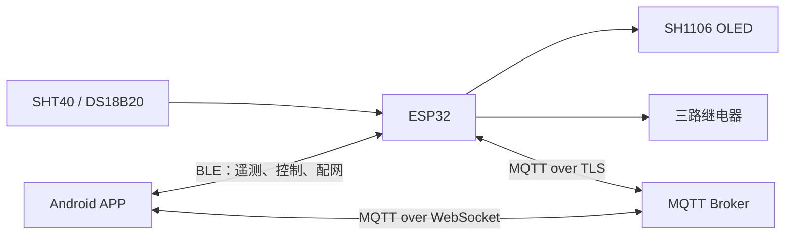

# 智慧农场 · SmartFarm

基于 **ESP32 + Android** 的环境监测与三路继电器控制项目，包含 ESP-IDF 固件、Kotlin / Jetpack Compose 手机端，以及 Altium Designer 24 原理图、PCB 和配套器件库。

设备采集空气温湿度与水温，在 OLED 上显示，并通过 BLE 和 MQTT 向手机提供数据与控制接口。手机靠近设备时优先使用蓝牙，蓝牙未就绪时可通过 MQTT 远程连接。

## 功能与进度

| 模块 | 当前实现 |
| --- | --- |
| 环境采集 | SHT40 空气温湿度、DS18B20 水温；传感器异常状态上报 |
| 本地显示 | SH1106 1.3 英寸 128×64 OLED |
| 执行控制 | 三路继电器手动控制、输出状态反馈 |
| 网络通信 | Wi-Fi、SNTP 校时、MQTT over TLS |
| 蓝牙 | BLE 遥测、指令回执、配对与 Wi-Fi 配网 |
| 设备端规则 | 定时规则、传感器条件规则、NVS 持久化 |
| Android APP | 实时数据、BLE 配网、MQTT over WebSocket、通道自动选择、继电器控制 |
| 硬件工程 | AD 原理图、PCB 与配套库，持续完善中 |

APP 的规则配置、规则列表和删除界面仍待开发。远程操作、离线超时及 BLE / MQTT 切换需结合手机和设备继续联调；硬件工程保留当前设计进度，尚不代表完成生产验证。

## 通信架构



通道选择以 BLE 是否就绪为依据：BLE 已完成连接与订阅时优先使用 BLE，否则使用已连接的 MQTT 通道。继电器开关以设备遥测状态为准，指令通过回执确认结果。

## 仓库目录

```text
smartfarm/
├── main/                       # ESP32 固件与凭据模板
├── app-android/                 # Android APP 与 JVM 单元测试
├── tools/                      # 环境准备、BLE / MQTT 调试脚本
├── hardware/altium/
│   └── test/
│       ├── test.PrjPcb          # AD 主工程
│       ├── Sheet1.SchDoc        # 原理图
│       ├── PCB1.PcbDoc          # PCB
│       └── library/             # 配套符号、封装及器件工程
├── CMakeLists.txt
├── sdkconfig.defaults          # 可复现的固件默认配置
└── partitions.csv              # Flash 分区表
```

公开仓库包含项目代码、AD 工程及配套器件库。数据手册、资料压缩包、本机凭据、构建产物和 AD 自动备份不在发布范围内。

## 硬件与引脚

固件目标为经典 ESP32，Flash 配置为 **4 MB**。当前引脚分配见 [main/board_pins.h](main/board_pins.h)。

| 外设 | 接口 / 用途 | GPIO | 地址 |
| --- | --- | --- | --- |
| SH1106 OLED | I²C：SDA / SCL | 21 / 22 | 0x3C |
| SHT40 | 独立 I²C：SDA / SCL | 25 / 26 | 0x44 |
| DS18B20 | 1-Wire：DQ | 4 | — |
| 继电器 1 / 2 / 3 | 控制输出 | 18 / 19 / 23 | — |
| 测试输入 1 / 2 / 3 | 内部下拉、高电平触发 | 27 / 32 / 33 | — |

继电器当前采用高电平触发，需配套驱动电路，线圈不可直接接 GPIO。DS18B20 建议使用外部三线供电，并在 DQ 与 3.3 V 之间接 4.7 kΩ 上拉电阻。接线时以实际模块和驱动配置为准。

## 获取项目

```powershell
git clone https://github.com/neltharion11/smartfarm.git
cd smartfarm
```

建议使用纯英文路径，例如 `F:\smartfarm`，避免 Windows 下 ESP-IDF 构建过程中的非 ASCII 路径问题。

## 构建 ESP32 固件

### 1. 准备环境

项目使用 ESP-IDF，当前开发环境基于 **ESP-IDF 6.0.2**。安装对应工具链后，在已加载 ESP-IDF 环境的终端中执行后续命令。

[tools/idf_env.ps1](tools/idf_env.ps1) 是针对开发机安装布局的辅助脚本；在其他电脑使用前，需要指定自己的 IDF 与工具目录，或直接使用官方环境终端。

### 2. 配置设备凭据

```powershell
Copy-Item main/secrets.h.example main/secrets.h
```

编辑 `main/secrets.h`，填写 Wi-Fi、MQTT Broker 地址、用户名和密码，并把 `SECRET_BLE_PASSKEY` 改成自己的六位配对码。模板见 [main/secrets.h.example](main/secrets.h.example)。

`main/secrets.h` 已被 Git 忽略。未创建该文件时，固件有空配置回退，但需要有效配置才能连接网络服务。

### 3. 编译、烧录和查看日志

在仓库根目录执行：

```powershell
idf.py set-target esp32
idf.py build
idf.py -p COM4 flash monitor
```

将 `COM4` 替换为实际串口，使用 `Ctrl+]` 退出串口监视。首次构建会下载 [main/idf_component.yml](main/idf_component.yml) 中声明的托管依赖，需要能够访问组件源。

持久化的默认构建配置在 [sdkconfig.defaults](sdkconfig.defaults)；调整 Flash、分区或蓝牙等配置后，应同步维护该文件。

## 构建 Android APP

当前工程配置为 **minSdk 26、compileSdk 37、targetSdk 36**。依赖版本集中在 [libs.versions.toml](app-android/gradle/libs.versions.toml)，本机开发使用 JDK 25 与 Gradle 9.7.1。

1. 用 Android Studio 打开 `app-android/`，安装工程要求的 Android SDK，并配置本机 SDK 路径。
2. 创建 APP 的本地 MQTT 配置：

   ```powershell
   Copy-Item app-android/mqtt.properties.example app-android/mqtt.properties
   ```

3. 编辑 `mqtt.properties`：填写 Broker 实际提供的 `mqtt.wsUri`、`mqtt.user`、`mqtt.password`，并让 `mqtt.topicRoot` 与设备主题前缀、节点标识保持一致。默认主题根为 `farm/node1`。
4. 完成 Gradle 同步后，通过 Android Studio 构建并运行到手机。

固件使用 MQTT TLS 地址，APP 使用 MQTT WebSocket 地址，两者应连接同一 Broker。WebSocket 路径、端口及 TLS 配置以你的 Broker 为准；示例文件不包含可直接使用的服务账号。

仓库当前未附带 Gradle Wrapper。已安装并配置好对应 Gradle 时，可在仓库根目录执行：

```powershell
gradle -p app-android :app:assembleDebug :app:testDebugUnitTest
```

单元测试覆盖遥测解析与分片重组、配网状态判定、通道选择、MQTT 配置和回执跟踪等逻辑，代码位于 [app/src/test](app-android/app/src/test)。

APP 的 MQTT 配置会写入生成的 APK。提交代码时使用配置模板；分发 APK 前，应确认其中账号的访问权限和分发范围。

## 打开 AD 工程

使用 **Altium Designer 24** 打开：

**[hardware/altium/test/test.PrjPcb](hardware/altium/test/test.PrjPcb)**

- 原理图：[Sheet1.SchDoc](hardware/altium/test/Sheet1.SchDoc)
- PCB：[PCB1.PcbDoc](hardware/altium/test/PCB1.PcbDoc)
- 器件库：[library/](hardware/altium/test/library/)

请保留工程与 `library/` 的相对目录关系。当前接口板设计围绕电源 / 保护、继电器驱动和连接器展开，ESP32、显示屏及传感器通过外部接口接入；打样前仍需完成原理图、封装、ERC / DRC 和实际连接复核。

## 开发入口

| 任务 | 入口 |
| --- | --- |
| 主循环与遥测组织 | [main/main.c](main/main.c) |
| 硬件引脚分配 | [main/board_pins.h](main/board_pins.h) |
| BLE 服务与配网 | [main/ble_svc.c](main/ble_svc.c) |
| MQTT 设备通道 | [main/mqtt_app.c](main/mqtt_app.c) |
| 指令解析 | [main/cmd.c](main/cmd.c) |
| 定时与条件规则 | [main/rules.h](main/rules.h)、[main/rules.c](main/rules.c) |
| APP 界面 | [MainActivity.kt](app-android/app/src/main/java/com/smartfarm/app/MainActivity.kt) |
| APP 通道选择 | [ChannelRouter.kt](app-android/app/src/main/java/com/smartfarm/app/channel/ChannelRouter.kt) |
| 调试工具 | [tools/](tools/) |

修改引脚、主题或指令协议时，应同步检查固件、APP 与硬件工程之间的一致性。

